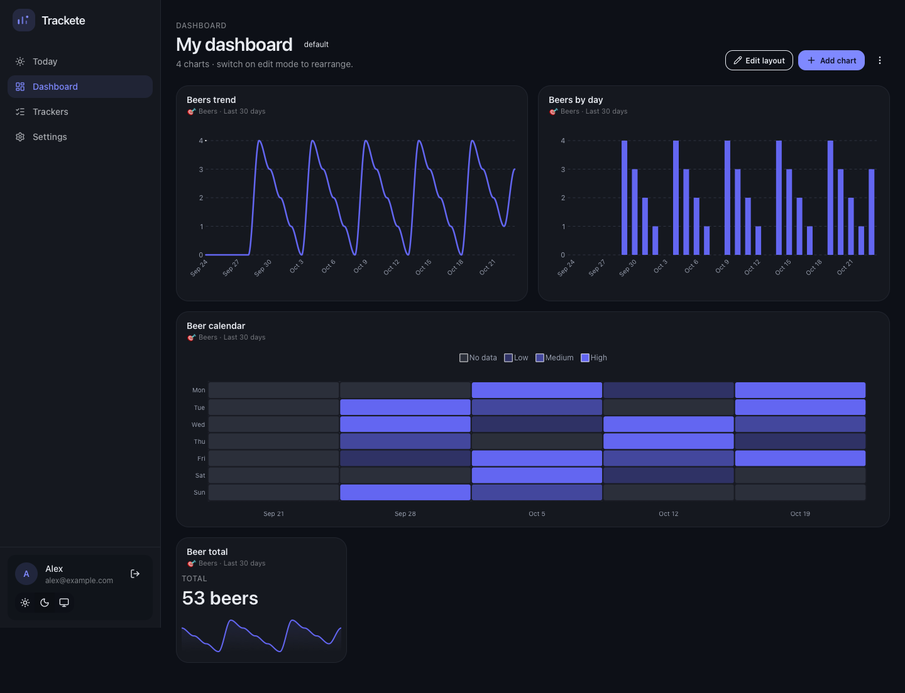

# Trackete

**Track anything. Build the dashboard you actually want.**

Trackete is a self-hosted generalist tracker. Create a yes/no habit or a number
with a unit — beers, weight, meditation, pages read — log it in seconds, then
arrange charts on a dashboard that is yours. One container, one SQLite file, no
external services.



## What you get

- **Yes/No and Number trackers**, each with an optional goal (`at least` / `at
  most`, per day, week or month).
- **One value per day**, quick steppers, and a detail view for editing history.
- **Six chart types** — line, bar, area, donut, calendar heatmap, stat card.
- **Drag-and-resize dashboards**, multiple dashboards, live statistics
  (streaks, completion, strongest weekday, on-target periods).
- **Multi-user accounts** with per-user data isolation, light/dark themes.

See [docs/ARCHITECTURE.md](docs/ARCHITECTURE.md) for the data model, chart
semantics and API.

## Quick start (Docker Compose)

```bash
git clone https://github.com/a-chris/trackete.git
cd trackete
cp .env.example .env          # then set JWT_SECRET in .env
docker compose up -d --build
```

Open <http://localhost:8080> and create an account.

### Prebuilt image (one-liner)

Release tags publish a multi-arch image to GHCR:

```bash
docker run -d --name trackete \
  -p 8080:8080 \
  -v trackete-data:/data \
  -e JWT_SECRET="$(openssl rand -hex 32)" \
  ghcr.io/a-chris/trackete:latest
```

> Until a `v*` tag has been pushed, use the Compose or source build below; the
> release workflow (`.github/workflows/release.yml`) creates the image.

### From source

Requirements: Go 1.27+ and Bun 1.4+. [mise](https://mise.jdx.dev) reads
`.mise.toml` and installs both.

```bash
mise install
make install                  # bun install
make build                    # frontend/dist + backend/trackete
STATIC_DIR=./frontend/dist DB_PATH=./data/trackete.db ./backend/trackete
```

## Critical configuration

| Variable | Why it matters |
| --- | --- |
| `JWT_SECRET` | **Set this.** Signs session cookies. If unset, a random secret is generated per boot and everyone is logged out on restart. Use `openssl rand -hex 32`. |
| `TRUSTED_PROXIES` | **Set this when behind a reverse proxy** (comma-separated IPs/CIDRs). Empty means no proxy is trusted: the forwarded client IP is ignored (so per-IP login throttling keys on the proxy) and `X-Forwarded-Proto` only marks cookies `Secure` when it comes from a trusted proxy. |
| `ALLOW_REGISTRATION` | Defaults to `true`. Set `false` once your accounts exist. |
| `TOKEN_TTL` | Session lifetime, default `720h` (30 days). |
| `DB_PATH` / volume | Everything lives in the SQLite file (Docker: `/data/trackete.db`). Mount a persistent volume. When overriding `DB_PATH`, keep it under `/data`, or the database lands outside the volume and is lost on restart. |
| `PORT` | HTTP port, default `8080`. |
| `STATIC_DIR` | Built SPA directory. Empty = API only (Docker sets `/app/dist`). |
| `CORS_ORIGINS` | Comma-separated extra origins for credentialed requests. Only for cross-origin development; wildcards are ignored. |

## Running behind HTTPS

Terminate TLS at your reverse proxy, forward `X-Forwarded-Proto: https`, and list
the proxy in `TRUSTED_PROXIES`. Cookies then become `Secure` automatically.

Caddy example:

```
trackete.example.com {
    reverse_proxy 127.0.0.1:8080
}
```

With Compose, bind the port to loopback only: `ports: ["127.0.0.1:8080:8080"]`
and put the proxy in front. Set `TRUSTED_PROXIES=127.0.0.1/32` (or the proxy's
Docker network) so forwarded headers are honored.

SQLite runs in WAL mode: to back up, archive the whole volume while the container
is stopped (or use `sqlite3 .backup`). Compose pins the volume name to
`trackete-data` (see `docker-compose.yml`), so these commands target exactly the
volume the container uses, whether it was created by Compose or by `docker run`.

```bash
docker compose stop trackete
docker run --rm -v trackete-data:/data -v "$PWD":/backup alpine \
  tar czf /backup/trackete-backup.tar.gz -C /data .
docker compose start trackete
```

## Development

```bash
make dev        # API with live reload (Air) on :8080 + Vite on :5173
make test       # Go vet/tests, TypeScript, ESLint, production build
```

`make dev` runs the API and the Vite dev server side by side; Vite proxies
`/api` to the API, so cookies stay same-origin. Editing a Go file (or an
embedded SQL migration) rebuilds and restarts the API — the first run installs
a pinned Air into `backend/.bin/`. The dev database lives in `data/`
(`DB_PATH`, gitignored).

Layout: `backend/` (Go API, SQLite store, embedded migrations, analytics) and
`frontend/` (React, DaisyUI themes, ApexCharts, dashboard grid).

## Notes

- Trackete logs one value per tracker per day; multiple entries per day and
  entry variants/tags are on the [roadmap](docs/ARCHITECTURE.md#roadmap).
- Charts render at most ten years of history; stored rows are never deleted.
- Registration can be closed; duplicate-email responses reveal that an account
  exists (intentional for a self-hosted install — close registration after
  setup).

Security policy: [SECURITY.md](SECURITY.md). Contributions:
[CONTRIBUTING.md](CONTRIBUTING.md). License: [MIT](LICENSE).
