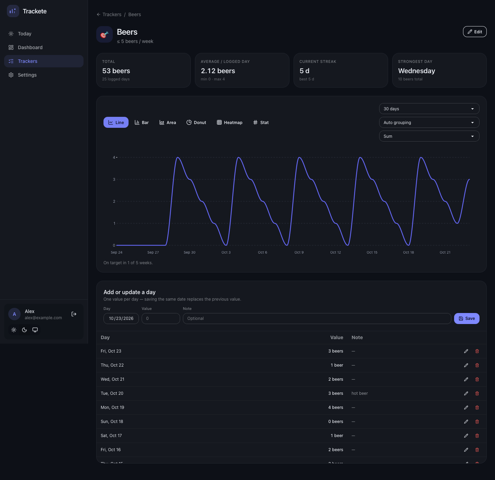
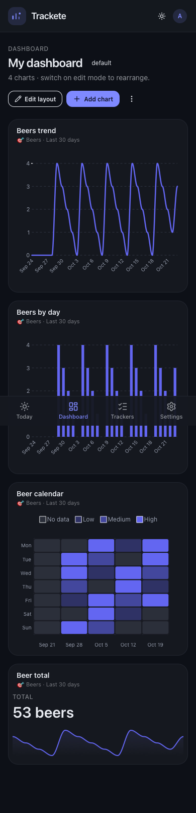

# Trackete

**Track anything. Build the dashboard you actually want.**

Trackete is a small, self-hosted generalist tracker. Create a yes/no habit or a
number with a unit — beers per week, weight, meditation, pages read — log it in
seconds, then arrange charts on a dashboard that is yours.

Think "spreadsheet freedom, dashboard opinions". One container, one SQLite file,
no external services.

```
Go + Gin + SQLite  ·  React + Vite + ApexCharts + DaisyUI + Tailwind
```

## Features

- **Two tracker types** — `Yes / No` habits and `Number` trackers with an
  optional unit and a target (`at least` / `at most`, per day, week or month).
- **Fast daily logging** — one value per day, `UPSERT` semantics, quick
  steppers on the Today screen.
- **Six chart types** — line, bar, area, donut, calendar heatmap and a
  headline stat card with sparkline.
- **Drag-and-resize dashboards** — a 12-column grid, multiple named dashboards, and
  add/edit/delete widgets in place.
- **Real statistics** — totals, per-day averages, completion rate, current and
  best streak, strongest weekday, on-target periods.
- **Multi-user** — email + password accounts, every tracker and dashboard scoped
  to its owner. Registration can be closed with an env var.
- **Light and dark themes**, following the system by default.
- **One-line deployment** with Docker, data in a single volume.

## Screenshots

| Dashboard | Tracker detail |
| --- | --- |
|  |  |



## Quick start

```bash
docker run -d --name trackete \
  -p 8080:8080 \
  -v trackete-data:/data \
  -e JWT_SECRET="$(openssl rand -hex 32)" \
  ghcr.io/a-chris/trackete:latest
```

Open <http://localhost:8080>, create an account, and add your first tracker.

> The image is published to GHCR by the release workflow. Until a release tag
> exists, build it yourself (below) — it is a two-minute build.

### With Docker Compose

```bash
git clone https://github.com/a-chris/trackete.git
cd trackete
cp .env.example .env          # then set JWT_SECRET
docker compose up -d --build
```

### From source

```bash
mise install                  # Go 1.27 and Node 24
make install
make build                    # frontend/dist + backend/trackete
STATIC_DIR=./frontend/dist DB_PATH=./data/trackete.db ./backend/trackete
```

## Configuration

| Variable | Default | Purpose |
| --- | --- | --- |
| `PORT` | `8080` | HTTP port. |
| `DB_PATH` | `/data/trackete.db` (Docker) | SQLite file. The directory is created if missing. |
| `JWT_SECRET` | random per boot | Signing key for session cookies. Set it to keep sessions across restarts. |
| `TOKEN_TTL` | `720h` | Session lifetime, any Go duration. |
| `ALLOW_REGISTRATION` | `true` | Set `false` to close sign-ups after creating your accounts. |
| `STATIC_DIR` | `/app/dist` (Docker) | Directory with the built frontend. Empty means API-only. |
| `CORS_ORIGINS` | empty | Comma-separated extra origins allowed with credentials. Only needed for cross-origin dev. |
| `APP_VERSION` | `dev` | Reported by `/api/health` and the Settings screen. |

## How it works

### Data model

- `users` — one row per account.
- `trackers` — name, icon, colour, `kind` (`boolean` / `numeric`), optional unit
  and goal. Goals are stored as JSON: `{type, value, period}`.
- `entries` — **one value per tracker per day** (`PRIMARY KEY (tracker_id, day)`).
  Days are local calendar dates (`YYYY-MM-DD`) picked by the browser, so no
  timezone surprises. Logging again replaces the value.
- `dashboards` / `widgets` — a widget points at one tracker, a chart type, a
  config (`range`, `granularity`, `aggregate`, `metric`) and a grid position.

### Chart data

The API returns chart-ready payloads (`labels`, `series`, optional `heatmap` /
`stat`, plus a `summary`). Aggregation happens server-side and is pure Go
(`backend/internal/analytics`), so the numbers are identical everywhere:

- `boolean` trackers chart as 1/0 per day and as *days on* per week/month.
- `numeric` trackers aggregate with either **sum** or **average over logged
  days** — missing days never dilute an average.
- Missing days count as 0 for streaks and per-period goals.
- Streaks are computed on "did I hit the target that day" (for numeric trackers
  without a daily goal: any value above 0).

### API

All routes are under `/api`. Authentication uses a session cookie (an
`Authorization: Bearer <token>` header also works for API clients).

| Method | Route | Purpose |
| --- | --- | --- |
| `GET` | `/health`, `/meta` | Health check, version, registration flag. |
| `POST` | `/auth/register`, `/auth/login`, `/auth/logout` | Session lifecycle. |
| `GET/PATCH` | `/auth/me` | Current profile. |
| `POST` | `/auth/password` | Change password. |
| `GET/POST` | `/trackers` | List (`?includeArchived=true`) and create. |
| `GET/PUT/DELETE` | `/trackers/:id` | Read, replace, delete. |
| `GET` | `/trackers/:id/data` | Chart payload (`?chart=&from=&to=&granularity=&aggregate=&metric=`). |
| `GET/PUT/DELETE` | `/trackers/:id/entries[/:day]` | Read, upsert, delete entries. |
| `GET` | `/overview` | Today's screen: per-tracker entry, period total, streak. |
| `GET/POST` | `/dashboards` | List and create dashboards. |
| `GET/PATCH/DELETE` | `/dashboards/:id` | Read, rename, delete. |
| `GET` | `/dashboards/:id/data` | Chart payloads for every widget. |
| `POST` | `/dashboards/:id/widgets` | Add a chart. |
| `PUT/DELETE` | `/widgets/:id` | Update or remove a chart. |
| `PUT` | `/dashboards/:id/layout` | Persist drag/resize positions. |

## Development

```bash
make dev        # Go API on :8080 + Vite on :5173
make test       # Go vet/tests, TypeScript, ESLint, production build
make docker-build
```

Repository layout:

```
backend/   Go API, SQLite store, embedded migrations, analytics
frontend/  React app, DaisyUI themes, ApexCharts wrappers, dashboard grid
Dockerfile multi-stage build → one Alpine image serving API + static SPA
```

## Deployment notes

- Put Trackete behind a reverse proxy with TLS. Forward `X-Forwarded-Proto`, and
  session cookies automatically become `Secure`.
- Back up the `trackete-data` volume:

  ```bash
  docker run --rm -v trackete-data:/data -v "$PWD":/backup alpine \
    tar czf /backup/trackete-backup.tar.gz -C /data .
  ```

- The database runs in WAL mode, so back up the directory, not just the `.db`.
- Single container, single writer-friendly SQLite: perfect for personal use and
  small groups. For heavy multi-tenant loads, the storage layer is isolated
  behind `internal/store` and can be swapped.

## Roadmap

The schema and the analytics package are built to grow:

- multiple entries per day (doses, meals, sets) with per-entry metadata
- quick variants/tags on entries ("hot beer" vs "cold beer") and distribution charts
- free-text notes in charts and a searchable journal
- more widgets: stacked bars, scatter, radial, tables, multi-tracker charts
- pattern detection ("you drink most on Saturdays") surfaced as insights
- CSV/JSON import and export

## Contributing

See [CONTRIBUTING.md](CONTRIBUTING.md). Security policy in [SECURITY.md](SECURITY.md).

## License

[MIT](LICENSE)
