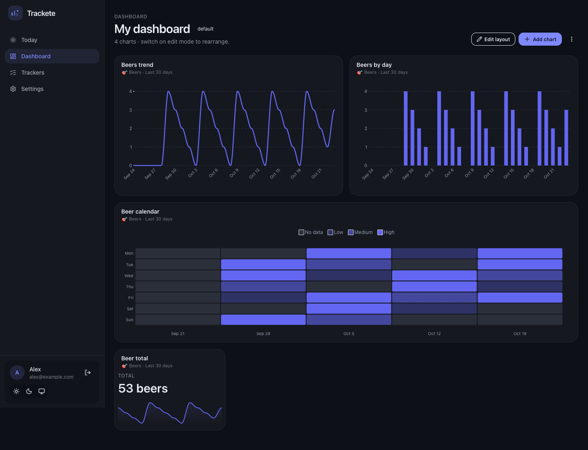

# Trackete

Self-hosted tracker for yes/no habits and for numbers with a unit: beers,
weight, meditation, pages read. Log a value in seconds, then arrange charts on a
dashboard you lay out yourself. One container, one SQLite file, no external
services.



## Features

- Yes/No and Number trackers, each with an optional goal (`at least` / `at
  most`, per day, week or month).
- One value per day, quick steppers, and a detail view for editing history.
- Six chart types: line, bar, area, donut, calendar heatmap, stat card.
- Drag-and-resize dashboards, multiple dashboards, live statistics (streaks,
  completion, strongest weekday, on-target periods).
- Multi-user accounts with per-user data isolation, light and dark themes.
- Shared trackers: invite people by email, each member logs their own value
  per day, and the charts show one series per member with a combined summary.

See [docs/ARCHITECTURE.md](docs/ARCHITECTURE.md) for the data model, chart
semantics and API.

## Quick start

Every commit on `main` publishes a multi-arch image to GHCR as
`ghcr.io/a-chris/trackete:latest`, and a `v*` tag publishes that tag name:
`v1.2.3` gives `ghcr.io/a-chris/trackete:v1.2.3`.

```bash
docker run -d --name trackete \
  -p 8080:8080 \
  -v trackete-data:/data \
  ghcr.io/a-chris/trackete:latest
```

Open <http://localhost:8080> and create an account.

The session secret is generated into `/data/.jwt-secret` on first start, so
nothing else is needed. Pass `-e JWT_SECRET=...` to manage the secret yourself,
and `-e ALLOW_REGISTRATION=false` once the accounts exist.

### Docker Compose

Use this to run a modified tree, or to keep the configuration in a file.

```bash
git clone https://github.com/a-chris/trackete.git
cd trackete
cp .env.example .env          # optional, see Configuration
docker compose up -d --build
```

Compose pins the volume name to `trackete-data`, the same volume the `docker run`
command above uses, so the two can be swapped without moving data.

### From source

Requires Go 1.27+ and Bun 1.4+. [mise](https://mise.jdx.dev) reads `.mise.toml`
and installs both.

```bash
mise install
make install                  # bun install
make build                    # frontend/dist + backend/trackete
STATIC_DIR=./frontend/dist DB_PATH=./data/trackete.db ./backend/trackete
```

## Configuration

The defaults work without an `.env`. `ALLOW_REGISTRATION` is the one setting to
change once your accounts exist.

| Variable | Default | Notes |
| --- | --- | --- |
| `ALLOW_REGISTRATION` | `true` | Set to `false` after the accounts exist. |
| `JWT_SECRET` | generated | Signs session cookies. When unset, a secret is generated on first run into `.jwt-secret` next to the database, inside the volume, so sessions survive restarts. Set it to pin the value or to rotate (set a new one, delete the file). If the secret cannot be stored, startup fails instead of signing everyone out at the next restart. Use `openssl rand -hex 32`. |
| `TOKEN_TTL` | `720h` | Session lifetime (30 days). |
| `DB_PATH` | `/data/trackete.db` | The SQLite file. Keep overrides under `/data`, otherwise the database lands outside the volume. |
| `PORT` | `8080` | HTTP port. In Compose this sets the published host port; the container always listens on 8080. |
| `APP_URL` | `http://localhost:8080` | The origin people actually open, used to build invitation links. Set it to your real address (`https://trackete.example.com`), otherwise invite emails point at the wrong host. |

### Optional

- `TRUSTED_PROXIES`: hops allowed to report the client address and scheme.
  Defaults to loopback plus the private ranges (`127.0.0.0/8`, `::1`,
  `fc00::/7`, `10.0.0.0/8`, `172.16.0.0/12`, `192.168.0.0/16`,
  `169.254.0.0/16`, `fe80::/10`), the same list Rails ships. Docker's bridge
  gateway and a proxy on the same host are inside those ranges, so a
  reverse-proxy deployment sets nothing. Override with a comma-separated list of
  IPs or CIDRs to narrow it, or `none` to trust no proxy, which makes per-IP
  login throttling key on the proxy address.
- `JWT_SECRET_FILE`: file holding the generated secret, used only when
  `JWT_SECRET` is empty. Defaults to `.jwt-secret` in the database directory.
- `STATIC_DIR`: built SPA directory. Empty serves the API only; the image sets
  `/app/dist`.
- `CORS_ORIGINS`: extra origins allowed to make credentialed requests. For
  cross-origin development only, and wildcards are ignored.
- `MAIL_TRANSPORT`: how invitation emails leave the process, one of `smtp`,
  `file` or `log`. Empty means `smtp` when `SMTP_HOST` is set, otherwise `file`.
- `SMTP_HOST`, `SMTP_PORT`: mail server and port, default `587`, STARTTLS is used
  when offered. Without a host, invitations stay pending and can be resent later.
- `SMTP_USERNAME`, `SMTP_PASSWORD`: credentials for SMTP AUTH, if your server
  needs them.
- `MAIL_FROM`: sender address, default `Trackete <no-reply@trackete.local>`. Many
  providers require a verified sender.
- `MAIL_FILE_PATH`: outbox file for the `file` transport, default `outbox.log`
  next to `DB_PATH`, so `/data/outbox.log` in Docker. This is where invite links
  appear when no SMTP server is configured.

## Sharing trackers

A tracker owner can invite people by email, from the tracker form or the Share
button on a tracker that already has members. The link in the invitation stays
valid for seven days.

- An existing account is signed in by accepting the link.
- A new invitee picks a display name and password on the acceptance page. This
  works even with `ALLOW_REGISTRATION=false`, so an invite-only instance is
  possible: close registration and hand out invitations.
- Members log their own value per day and see every member's entries and charts.
  Only the owner can edit the tracker, invite people or remove members, and a
  member can change only their own entries.

Invitations are always recorded, even when delivery fails. Such an invitation
shows as *not delivered* and the owner can resend it. Invitation history survives
rejection and removal, so the invite field can suggest addresses used before.

Without an SMTP server the `file` transport writes each message, links included,
to `MAIL_FILE_PATH`, which is `outbox.log` next to the database by default:

```bash
docker compose exec trackete tail -n 40 /data/outbox.log
```

Copy the `/invite/...` link from that file to accept the invitation yourself
during development. `MAIL_TRANSPORT=log` writes the same content to the container
log instead.

## Behind HTTPS

Terminate TLS at the proxy and forward `X-Forwarded-Proto: https`. Cookies are
marked `Secure` because the proxy is inside the default `TRUSTED_PROXIES`
ranges.

```
trackete.example.com {
    reverse_proxy 127.0.0.1:8080
}
```

Publish the port on loopback only, so the container is reachable through the
proxy and nowhere else: `-p 127.0.0.1:8080:8080` for `docker run`, or
`ports: ["127.0.0.1:8080:8080"]` in Compose.

## Backup

SQLite runs in WAL mode. Archive the volume with the container stopped, or use
`sqlite3 .backup`.

```bash
docker compose stop trackete
docker run --rm -v trackete-data:/data -v "$PWD":/backup alpine \
  tar czf /backup/trackete-backup.tar.gz -C /data .
docker compose start trackete
```

## Development

```bash
make dev        # API with live reload (Air) on :8080, Vite on :5173
make test       # Go vet and tests, TypeScript, ESLint, build, UI class check
```

`make dev` runs the API and Vite side by side. Vite proxies `/api` to the API,
so cookies stay same-origin. Editing a Go file, or an embedded SQL migration,
rebuilds and restarts the API; the first run installs a pinned Air into
`backend/.bin/`. The dev database lives in `data/` (`DB_PATH`, gitignored).

Layout: `backend/` (Go API, SQLite store, embedded migrations, analytics) and
`frontend/` (React, DaisyUI themes, ApexCharts, dashboard grid).

## Notes

- Each member logs one value per tracker per day. Multiple entries per member
  per day and entry variants/tags are on the [roadmap](docs/ARCHITECTURE.md#roadmap).
- Charts render at most ten years of history. Stored rows are never deleted.
- Registration can be closed. Duplicate-email responses reveal that an account
  exists, which is intentional for a self-hosted install; close registration
  after setup.

Security: [SECURITY.md](SECURITY.md). Contributing:
[CONTRIBUTING.md](CONTRIBUTING.md). License: [MIT](LICENSE).
